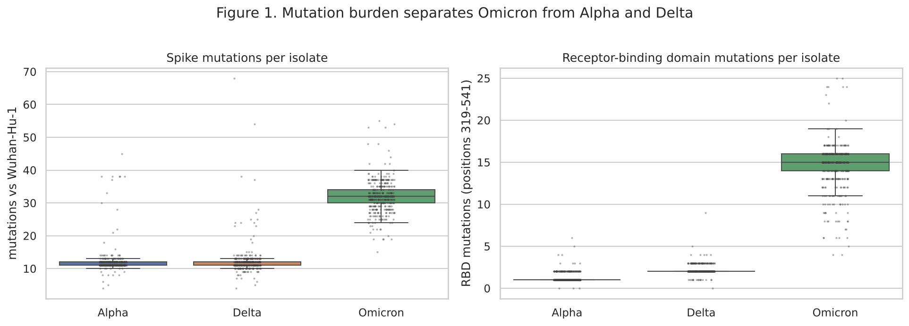
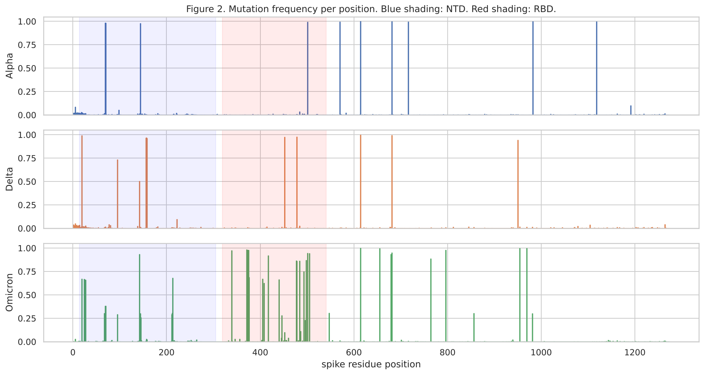
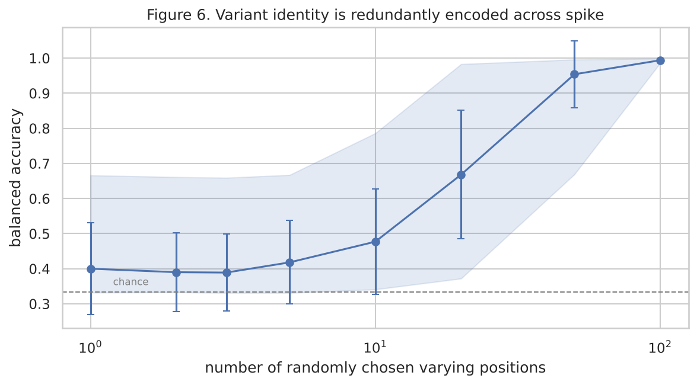
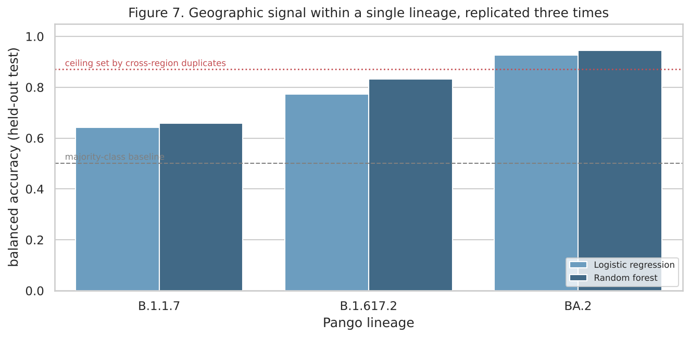

# COVID Variant Analysis

A study of how the COVID virus changed between the Alpha, Delta and Omicron
variants, and a test of what can be predicted from a virus sequence using
machine learning.

Computing Bioinformatics group project, Strathmore University.

Main file: [`deliverables/spike_variation_analysis.ipynb`](deliverables/spike_variation_analysis.ipynb)

## Background

The virus uses a protein called spike to enter human cells. Spike is 1,273
amino acids long, and each amino acid sits at a numbered position. Every
sample of the virus has a version of spike that differs from the original
2019 sequence at a small number of these positions.

We converted 1,406 virus samples into a table of 1,406 rows and 1,273
columns. Each row is one sample, each column is one position, and a cell
holds 1 if that position changed and 0 if it did not. All the analysis below
works from that table.

## Research questions

1. At which positions do the three variants differ from one another?
2. Is that difference concentrated in the part of spike that binds to human
   cells, or spread across the whole protein?
3. Can a model predict which region of the world a sample came from, using
   only its sequence?

## Results

### Figure 1. Number of mutations per sample

**What the figure shows.** Each point is one virus sample. The left panel
counts mutations anywhere in spike, and the right panel counts only those in
the receptor binding region, which is the part that attaches to human cells.
The boxes show the middle half of each group.

**What we draw from it.** Alpha and Delta carry around 11 to 12 mutations
each, while Omicron carries about 32. The gap is much wider in the receptor
binding region, where the medians are 1 for Alpha, 2 for Delta and 15 for
Omicron. The three groups barely overlap, so mutation count alone separates
Omicron from the other two.

These values were calculated from the sequences alone and agree with figures
published elsewhere, which were never supplied to the program. This confirms
the processing steps are correct before any further analysis is trusted.

### Figure 2. Where along the protein the changes occur

**What the figure shows.** The horizontal axis runs along all 1,273 positions
of spike. The height of each line is the proportion of samples in that
variant with a change at that position. Blue shading marks the N-terminal
region and red shading marks the receptor binding region.

**What we draw from it.** Changes are not scattered evenly. Each variant has
a small set of positions where almost every sample has changed, and long
stretches where almost none have. Omicron shows a dense band of changes
through the receptor binding region, which Alpha and Delta do not. Testing
every position individually and correcting for the number of tests, 83
positions out of the 583 that vary at all differ significantly between
variants.

### Figure 3. How many positions are needed to identify a variant

**What the figure shows.** We trained a classifier using only a random
selection of positions, repeated the selection many times at each size, and
recorded the average accuracy. The line is the average and the shaded band
covers the best and worst selections at each size.

**What we draw from it.** Accuracy rises from near chance with one position
to almost perfect with one hundred. About fifty randomly chosen positions are
enough to identify a variant reliably. The wide band at small sizes shows why:
a small selection either happens to include a position that defines a variant,
or it does not.

This explains an earlier result. Deleting the entire receptor binding region
from the data did not reduce accuracy at all, and using that region on its own
also worked. No single part of the protein is necessary, because the same
information is repeated in several places.

### Figure 4. Predicting the region a sample came from

**What the figure shows.** Accuracy at telling European samples from North
American ones, measured separately within three closely related groups of
virus. The dashed line is the score from always guessing whichever region is
more common, and the dotted line is the highest score any model could reach,
explained under Limitations.

**What we draw from it.** All three groups score above the guessing baseline,
so sequence carries some information about where a sample came from. The
effect is weakest in B.1.1.7 and strongest in BA.2. Because the result appears
in three groups tested separately, it is unlikely to be an accident of one
dataset.

## Final results

| Measure | Result |
|---|---|
| Samples downloaded | 14,965 |
| Distinct sequences analysed | 1,406 |
| Positions that vary at all | 583 |
| Positions differing significantly between variants | 83 |
| Median mutations in the receptor binding region | Alpha 1, Delta 2, Omicron 15 |
| Accuracy predicting variant, full protein | 1.000 |
| Accuracy predicting variant, binding region deleted | 1.000 |
| Random positions needed to identify a variant | about 50 |
| Accuracy predicting region, B.1.1.7 | 0.659 |
| Accuracy predicting region, B.1.617.2 | 0.832 |
| Accuracy predicting region, BA.2 | 0.944 |
| Guessing baseline for region | 0.500 |
| Highest score any sequence-based model could reach | 0.871 |

Accuracy is balanced accuracy, which averages the score across both regions so
that a model is not rewarded for always choosing the more common one.

## An error we identified and corrected

Our first attempt at predicting region grouped samples only by variant, and
reached 0.944 for Omicron. We then examined which columns the model was
relying on, and found they were the positions that separate Omicron's
sub-types from each other, rather than positions that separate continents.

The cause was visible in the sample counts. One sub-type made up 31 per cent
of the North American samples and under 3 per cent of the European ones. The
model was identifying the sub-type, and the region followed from that without
any geographic information being used.

We repeated the analysis within single sub-types, so that this shortcut was
unavailable. The effect remained, and those corrected values are the ones
reported in Figure 4.

## Why we did not simply predict the variant

Predicting the variant from spike was the original plan. It cannot support a
research question, because variants are defined by these mutations in the
first place. A model asked to predict the variant is recovering the rule used
to assign the labels, which is why it reaches a perfect score, and why
grouping the samples without any labels at all also recovers the variants
almost exactly. We retained this task only as a check that the data was
correctly prepared.

## Data

| Item | Source |
|---|---|
| Reference sequence | Nextstrain, GenBank MN908947 |
| Known variant mutations | CoVariants |
| Sample details, including variant, date and country | NCBI Datasets v2 API |
| Protein sequences | NCBI E-utilities |

Of the 14,965 records downloaded, 1,406 were analysed. Most of the reduction
is duplication: many samples have identical spike sequences, and keeping them
would have placed copies of the same sequence in both the training and testing
data, allowing a model to score well by memorising rather than generalising.

## Conclusion

This project set out to describe how spike differs between three variants of
the COVID virus, to establish whether those differences sit in one functional
part of the protein, and to test whether a virus sequence carries information
beyond the label already attached to it.

The variants differ at a limited and consistent set of positions, and Omicron
differs from the others far more than they differ from each other. That
difference is not confined to the receptor binding region. Deleting the region
entirely left variant identification unaffected, and roughly fifty arbitrary
positions were sufficient, which indicates the information is duplicated
across the protein rather than held in one functional area. Finally, sequences
carry a measurable signal about geographic origin within a single sub-type,
weaker than variant identity but consistently above chance.

### Where this approach could be applied

The findings suggest three uses, each limited by the constraints noted below.

**Reduced sequencing for variant identification.** If about fifty positions
are enough to identify a variant, a laboratory does not need the full protein
to do so. Panels that read a limited number of positions are cheaper and
faster than complete sequencing, which matters where sequencing capacity is
limited.

**Supporting origin assessment in surveillance.** A model that predicts
geographic region from sequence could help indicate whether a case is likely
to be locally acquired or imported, as one input alongside travel history and
contact tracing. The accuracy reported here is too low for this to be used on
its own.

**A method applicable beyond this virus.** The confounding we identified, in
which a model appeared to predict geography while actually detecting sub-type,
occurs whenever the labels being predicted correlate with how the samples are
related to one another. Checking which features a model relies on, and then
repeating the analysis within closely related groups, is a general safeguard
and applies to any biological classification task of this kind.

## Limitations

The variant prediction task is circular, as explained above, and is reported
only as a check.

Samples reflect where sequencing was carried out rather than where the virus
was circulating. After duplicates were removed, too few distinct sequences
remained from Africa and Asia to include them, so the geographic result covers
Europe and North America only.

Some identical sequences were collected on different continents. No model
using only the sequence can assign all of those correctly, which sets an upper
limit of 0.871 on geographic accuracy. This figure is reported alongside the
model scores.

Closely related samples still group together even within a single sub-type.
The geographic signal is therefore real and repeatable, but this work cannot
establish that geography is its cause.

Full detail is given in Stage 8 of the notebook.
